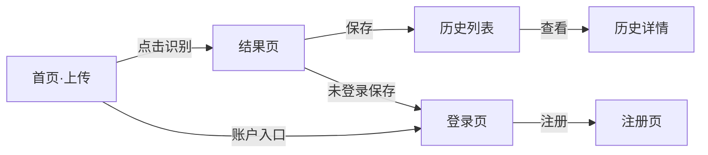

# 基于 CNN 的农作物叶片病害识别系统 — UI/UX 设计文档

> 版本：V1.0（设计阶段 M1）｜ 对应任务书 2.2 六模块、3.1 前端要求

## 1. 设计原则
- **响应式优先**：PC 与移动端浏览器同一套界面，移动端单列流式布局。
- **极简操作**：核心路径「上传 → 识别 → 看结果」三步可达，零学习成本。
- **可信可视化**：概率以条形图呈现，并附免责声明，降低误用风险。
- **组件库**：采用 Ant Design（复杂表单/表格优先）或 TailwindCSS（轻量定制优先）；本期默认 **Ant Design** 以保证表格/表单一致性。

## 2. 信息架构
```
首页 / 识别
  ├─ 上传区（拖拽 + 点击）
  ├─ 原图预览
  └─ 识别按钮
结果页
  ├─ 预测病害（中文名 + 置信度）
  ├─ Top-3 概率条形图
  ├─ 病害特征说明 + 防治建议
  ├─ 免责声明
  └─ 保存到历史（登录后）
历史页（需登录）
  ├─ 列表（缩略图 + 病害 + 时间）
  ├─ 详情（原图 vs 结果对比）
  └─ 导出（CSV/JSON）
账户
  ├─ 注册 / 登录 / 登出
  └─ 个人信息 / 修改密码
```

## 3. 页面流（Mermaid）


## 4. 核心页面与组件

### 4.1 识别页（首页）
| 区域 | 组件 | 说明 |
|---|---|---|
| 顶部导航 | NavBar | Logo、历史、账户入口 |
| 上传区 | Upload.Dragger | 拖拽/点击；格式与大小校验；即时预览 |
| 操作 | Button「开始识别」 | 上传后可用，loading 态 |
| 提示 | Alert | 格式错误/超限/网络异常 |

### 4.2 结果页
| 区域 | 组件 | 说明 |
|---|---|---|
| 标题 | Typography | 预测病害名 + 置信度徽标 |
| 概率图 | BarChart / Progress | Top-3 各类别概率条形图 |
| 知识卡 | Descriptions/Card | 病害特征、防治措施（来自知识表） |
| 免责 | Alert(type=warning) | 农技服务免责声明（固定展示） |
| 操作 | Button | 保存到历史（需登录）、重新识别 |

### 4.3 历史页
| 区域 | 组件 | 说明 |
|---|---|---|
| 列表 | Table/List | 缩略图、病害、置信度、时间、操作 |
| 详情 | Drawer/Modal | 原图 + Top-3 结果对比 |
| 导出 | Button | CSV / JSON 下载 |

### 4.4 账户页
| 区域 | 组件 | 说明 |
|---|---|---|
| 注册/登录 | Form | 用户名/邮箱、密码（哈希传输） |
| 个人信息 | Form | 昵称、修改密码 |

## 5. 交互状态
- 加载：识别中 Button loading + 骨架屏。
- 空态：未上传时上传区引导文案。
- 错误：统一 Toast/Alert，不暴露堆栈。
- 鉴权：未登录访问历史/个人信息 → 跳转登录并保留回跳。

## 6. 视觉规范（建议）
- 主色：农业绿 `#2E7D32`；辅色：警戒橙 `#EF6C00`（病害提示）。
- 字体：系统无衬线；移动端 ≥ 14px。
- 圆角：8px；卡片阴影克制。
- 无障碍：颜色不单独承载信息（概率同时标数值）。

## 7. 原型交付说明
本期先以本文档 + 组件清单作为设计基线；可据此用 Figma / 墨刀产出高保真原型，或前端直接按 Ant Design 组件实现（无需单独出图即可进入 M4 开发）。
